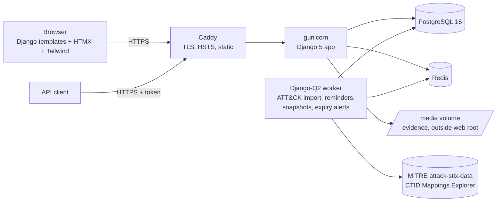

# ThreatLedger — Implementation Plan

Status: **Approved and implemented** (phases 1–7, v0.1.0). Notes under each phase record how it was built.
Open questions are collected in §11; defaults are marked so work can proceed if you accept them.

---

## 1. Goals and the core invariant

ThreatLedger links four things in one graph:

```
Risk ──uses──▶ ATT&CK Technique ◀──mitigates── Control ──satisfies──▶ Requirement
                      ▲                            │
                      └── ATT&CK Mitigation ◀──────┘ (control implements M-id)
```

**Invariant:** coverage, risk views and compliance % are *derived*, never stored as
source-of-truth. A control's `status` is the single input; everything downstream is
computed from it by one service layer. Changing one control therefore changes every
view on the next read — no sync jobs, no signals that can drift.

Stored snapshots exist only for *history* (trend charts), written by a scheduled job and
on demand, and are never read to answer "what is the current state".

---

## 2. Architecture



| Concern | Choice | Why |
|---|---|---|
| Web | Django 5.2 LTS, server-rendered templates, HTMX for partial updates | Brief; LTS gives support to 2028 |
| CSS | Tailwind via the **standalone CLI binary** in a Docker build stage | No Node.js in the image or on dev machines |
| Jobs | **Django-Q2 with Redis broker** (default; see Q3) | One less service than Celery (no beat), Django-native schedules in admin |
| Proxy | **Caddy** | Automatic HTTPS (Let's Encrypt, or internal CA for `localhost`) with minimal config |
| API | DRF + drf-spectacular, token auth, DRF throttling | Brief |
| Container | Multi-stage build, `python:3.12-slim`, non-root UID 10001, read-only root FS where possible | Security reqs |

### Layering inside Django

```
views / api (thin)  →  services (business rules, transactions, audit)  →  models (data + validation)
                              ↑
                      selectors / coverage engine (read-only computation)
```

- **All writes go through `services/`** so audit logging, score history and permission
  checks happen in one place — views and API serializers both call the same services.
- **`coverage/engine.py`** is a pure-Python module: given control statuses and the mapping
  graph, it returns technique coverage, risk coverage and requirement status. Easy to
  unit-test to high coverage; no DB access inside the core functions (data is loaded by
  selectors in a handful of queries, then computed in memory).

---

## 3. Data model

Conventions: every business model has `id` (BigAuto), `created_at`, `updated_at`,
`created_by`, `updated_by`; soft-delete via `archived_at` for Risk/Control/Asset so audit
references never dangle. Choices are `TextChoices` enums.

### 3.1 Organisation & identity (`apps.accounts`, `apps.org`)

| Model | Key fields |
|---|---|
| `Organisation` | name, slug, risk-matrix config (FK), settings JSON |
| `BusinessUnit` | org FK, name, parent FK (self, optional tree) |
| `User` | custom `AbstractUser` (set *before* first migration — irreversible), email unique, `mfa_enabled` |
| `Membership` | user FK, org FK, role (`admin`/`risk_manager`/`control_owner`/`auditor`/`viewer`), business_units M2M (optional scope) |

Roles → permissions are defined in code (`accounts/permissions.py`) as a single matrix,
mapped to Django groups by a data migration so the admin also respects them.

| Capability | Admin | Risk Mgr | Control Owner | Auditor | Viewer |
|---|:-:|:-:|:-:|:-:|:-:|
| Manage users, settings, imports | ✓ | | | | |
| Create/edit risks, acceptances | ✓ | ✓ | | | |
| Edit *owned* controls, upload evidence, record tests | ✓ | ✓ | ✓ (own) | | |
| Edit any control, frameworks, mappings | ✓ | ✓ | | | |
| Read everything incl. audit log & evidence | ✓ | ✓ | ✓ | ✓ | |
| Read dashboards, risks, coverage (no evidence files, no audit log) | ✓ | ✓ | ✓ | ✓ | ✓ |

Object-level checks ("control owner can edit only their controls") are enforced in a
single `can(user, action, obj)` function used by views, HTMX endpoints and DRF permission
classes. Every view is deny-by-default (a test walks the URLconf and fails if any view
lacks a permission declaration).

### 3.2 Assets & risks (`apps.risks`)

| Model | Key fields |
|---|---|
| `Asset` | org, BU, name, type (enum: application/server/endpoint/network/data_store/cloud_service/saas/people/facility/other), owner FK, criticality 1–5, data_classification (public/internal/confidential/restricted), `contains_personal_data` bool |
| `RiskMatrix` | org, size (default 5), likelihood labels[], impact labels[], band thresholds (Low ≤4, Med 5–9, High 10–15, Crit ≥16 defaults) |
| `Risk` | org, BU, ref (auto `R-0001`), title, scenario (text), category (enum), assets M2M, owner FK, inherent_likelihood, inherent_impact, residual_likelihood, residual_impact, treatment (mitigate/accept/transfer/avoid), status (draft/open/in_treatment/accepted/closed), target_date, next_review_date |
| `RiskScoreHistory` | risk FK, inherent L/I, residual L/I, changed_by, changed_at, reason — appended by the service on every score change |
| `RiskTechnique` | risk FK, technique FK, rationale — *through* model (risk↔technique) |
| `RiskControl` | risk FK, control FK, note — *through* model (risk↔control) |
| `RiskAcceptance` (Exception) | risk FK (or control FK for control exceptions), justification, approved_by FK, approved_at, expires_at, status (pending/approved/rejected/expired) |

Scores are computed properties (`L × I`), banded via the org's `RiskMatrix`; nothing stored
that could disagree with the inputs.

### 3.3 ATT&CK (`apps.attack`)

| Model | Key fields |
|---|---|
| `AttackRelease` | domain (`enterprise-attack`), version (e.g. `18.1`), stix bundle sha256, imported_at, imported_by, source (url/file), counts JSON |
| `Tactic` | stix_id (unique), attack_id (`TA0001`), name, shortname (`initial-access`), order (from `x-mitre-matrix.tactic_refs`), description, url |
| `Technique` | stix_id (unique), attack_id (`T1059` / `T1059.001`), name, description, parent FK (self, null for top-level), is_subtechnique, tactics M2M, platforms[], data_sources[], detection, url, `is_deprecated`, `is_revoked`, `revoked_by` FK (self), last_seen_release FK |
| `Group` | stix_id, attack_id (`G0016`), name, aliases[], description, url, deprecated/revoked flags |
| `Software` | stix_id, attack_id (`S0001`), name, type (malware/tool), aliases[], platforms[] |
| `Mitigation` | stix_id, attack_id (`M1032`), name, description |
| `DataSource` / `DataComponent` | stix_id, attack_id (`DS0017`/`DC0001`), name, description, log sources; component → source FK. **Data sources are all deprecated since v18**, kept only for older bundles |
| `DetectionStrategy` / `Analytic` | v18+ detection model: strategy (`DET…`) detects techniques; analytics (`AN…`, platforms) belong to strategies and reference data components |
| `GroupTechnique`, `SoftwareTechnique`, `GroupSoftware` | "uses" links with procedure description |
| `MitigationTechnique` | "mitigates" links |
| `DetectionStrategyTechnique` | v18+ "detects" links |
| `DataComponentTechnique` | legacy (pre-v18) "detects" links |
| `ImportRun` | status, requested version, requested_by, stats, message — one row per import attempt |

_Implementation note (Phase 2):_ verified against ATT&CK v18.1, v19.2 and v20.1. Campaigns (`campaign`, ~57 objects) are not imported yet; they can feed the threat-group coverage scope in Phase 6 if wanted. All base fields live on an abstract `AttackObject` (stix_id, attack_id, flags, `last_seen_release`).

Indexes: `attack_id`, trigram GIN index on `name` (Postgres `pg_trgm`) for the HTMX search;
falls back to `icontains` on SQLite.

### 3.4 Controls & evidence (`apps.controls`)

| Model | Key fields |
|---|---|
| `Control` | org, ref (`CTL-MFA-01`), name, description, owner FK, type (preventive/detective/corrective), status (implemented/partial/planned/not_implemented), effectiveness 1–5, last_tested_at, last_test_result (pass/partial/fail/not_tested), review_frequency_days |
| `ControlTechnique` | control FK, technique FK, source (manual/derived/ctid), note |
| `ControlMitigation` | control FK, mitigation FK (control implements M-id) |
| `ControlTest` | control FK, tested_at, tester FK, method (inquiry/observation/inspection/reperformance), result, notes, evidence M2M |
| `Evidence` | control FK, kind (file/link), file (private storage), url, original_filename, content_type, size, sha256, uploaded_by, uploaded_at, valid_until (expiry) |

### 3.5 Frameworks (`apps.frameworks`)

| Model | Key fields |
|---|---|
| `Framework` | code (`NIST-800-53-R5`), name, version, publisher, source_url, licence_note, is_indicative |
| `Requirement` | framework FK, parent FK (self — domain → requirement → enhancement), ref (`AC-2`, `A.5.1`, `CC6.1`), title, text, order, `is_domain` (grouping node, not counted) |
| `RequirementScope` | org FK, requirement FK, applicable bool, justification — lets an org mark items N/A (removes from "tracked") |
| `ControlRequirement` | control FK, requirement FK, source (manual/seed/import), `indicative` bool |
| `RequirementMapping` | from_req FK, to_req FK, relationship (equivalent/subset/superset/related), source, `indicative` bool |
| `TechniqueRequirement` | technique FK, requirement FK, source=`ctid`, ctid mapping version — CTID ATT&CK↔800-53 mapping |

### 3.6 Audit (`apps.audit`)

| Model | Key fields |
|---|---|
| `AuditEvent` | id, at, actor FK (nullable for system), actor_label (string snapshot), action (create/update/delete/login/login_failed/export/import/permission_denied), object_type, object_id, object_repr, changes JSON `{field: [before, after]}`, request_id, ip (hashed or truncated, see §7), `prev_hash`, `hash` |

Immutability, in depth:
1. Model `save()` refuses updates; `delete()` raises; manager has no bulk update/delete.
2. Admin is read-only (no add/change/delete permissions for anyone).
3. **Postgres trigger** (migration `RunSQL`) rejects `UPDATE`/`DELETE`/`TRUNCATE` on the table.
4. **Hash chain**: `hash = sha256(prev_hash + canonical_json(row))`; `manage.py audit_verify` detects tampering.
5. Sensitive fields (passwords, tokens, TOTP secrets, file contents) are excluded from diffs by an allowlist per model.

### 3.7 History & snapshots (`apps.reporting`)

| Model | Purpose |
|---|---|
| `ComplianceSnapshot` | date, framework, met/partial/gap/no_control/total counts, % — daily job |
| `CoverageSnapshot` | date, scope, covered/partial/gap counts |
| `RiskSnapshot` | date, counts by band (inherent & residual) |

---

## 4. Computation rules (the coverage engine)

All in `apps/coverage/engine.py`, pure functions, exhaustively unit-tested.

**Control → status rank:** implemented = 3, partial = 2, planned = 1, not_implemented = 0.

**Technique coverage** (per technique):
1. Collect controls linked to the technique **directly** (`ControlTechnique`) **and via
   mitigation** (`Control → ControlMitigation → Mitigation → MitigationTechnique`). *(Q5)*
2. Best rank among them: 3 → **Covered**, 2 → **Partial**, else → **Gap**.
3. **Sub-techniques inherit parent coverage:** a sub-technique's status =
   `max(own status, parent status)`. A parent's status is computed from its own mappings only
   (it does not roll up from children). *(Q6)*
4. Revoked/deprecated techniques are excluded from matrices but keep their mappings.

**Risk coverage view:** for each risk, coverage of each linked technique + a summary
(e.g. "4 of 6 techniques covered, 1 partial, 1 gap") and the list of linked controls.

**Suggested controls for a risk:** controls mapped (directly or via mitigation) to any of
the risk's techniques, not yet linked to the risk, ranked by number of the risk's
techniques they address, then by status. Plus ATT&CK mitigations for those techniques
that *no* control implements yet ("create a control for M1032").

**Requirement status** (per in-scope requirement): *(Q7)*
- No mapped controls → **No control**
- All mapped controls implemented → **Met**
- At least one mapped control implemented or partial → **Partial**
- Mapped controls exist, none implemented/partial → **Gap**

**Framework %** = `(met + 0.5 × partial) ÷ tracked`, where tracked = applicable,
non-domain requirements (No control counts in the denominator as 0).

**Risk score** = L × I; band thresholds from the org's `RiskMatrix` (defaults per brief).

**Performance:** the engine loads the mapping graph in ~6 queries and computes in memory
(full Enterprise ATT&CK ≈ 800 techniques incl. subs; 1,000 risks; ~1,000 NIST controls —
well within budget). Results are cached in Redis keyed on a `coverage_version` counter
bumped by the service layer on any control/mapping write, so caching can never serve stale
state after a change.

---

## 5. Folder structure

```
threatledger/
├── PLAN.md  CLAUDE.md  README.md  LICENSE  CONTRIBUTING.md  SECURITY.md  CHANGELOG.md
├── pyproject.toml            # deps, ruff, mypy, pytest, coverage, bandit config
├── uv.lock / requirements*.txt (pinned, hashed — see Q2)
├── manage.py
├── Dockerfile                # multi-stage: tailwind build → python deps → runtime (non-root)
├── docker-compose.yml        # app, worker, postgres, redis, caddy
├── docker-compose.override.example.yml
├── .env.example              # every setting documented, no real secrets
├── deploy/
│   ├── Caddyfile
│   └── entrypoint.sh         # wait-for-db, migrate, collectstatic, exec gunicorn
├── .github/workflows/ci.yml  # lint, mypy, tests+coverage, bandit, pip-audit, docker build, trivy (Q8)
├── config/
│   ├── settings/{base,dev,test,prod}.py
│   ├── urls.py  wsgi.py  asgi.py
├── threatledger/             # Django apps
│   ├── core/                 # base models/mixins, health check, layout, templatetags, utils (CSV safe export)
│   ├── accounts/             # User, Membership, roles, permissions, MFA, lockout
│   ├── org/                  # Organisation, BusinessUnit, RiskMatrix
│   ├── audit/                # AuditEvent, middleware, service, verify command
│   ├── attack/               # ATT&CK models, STIX importer, browser views
│   ├── risks/                # Asset, Risk, history, acceptance, heatmaps, export
│   ├── controls/             # Control, Evidence, tests, starter library
│   ├── frameworks/           # Framework, Requirement, mappings, importers, gap views
│   ├── coverage/             # engine.py (pure), selectors, coverage matrix, Navigator export
│   ├── reporting/            # dashboard, snapshots, board report
│   └── api/                  # DRF routers, serializers, permissions, throttles
│   (each app: models.py, services.py, selectors.py, views.py, forms.py, urls.py,
│    admin.py, tasks.py, management/commands/, templates/<app>/, tests/)
├── templates/                # base.html, partials/, components/
├── static/src/               # tailwind input.css, htmx (vendored, pinned + SRI), app.js
├── data/
│   ├── frameworks/           # seed files (YAML), each with licence/source header
│   ├── controls/starter.yaml
│   ├── demo/                 # demo company seed
│   └── attack/               # optional offline STIX bundle cache (git-ignored)
└── tests/                    # cross-app: e2e flows, permission sweep, perf check
```

---

## 6. Phases

Each phase ends with: `pytest` green, `ruff check` + `ruff format --check`, `mypy`,
`bandit`, `pip-audit` clean → commit → short summary to you. I will not start the next
phase until you've seen the summary.

### Phase 1 — Foundation
- `git init`, scaffold, settings split, `.env.example`, env-driven config (no defaults for secrets in prod — startup fails if `SECRET_KEY` missing)
- Custom User, Organisation, BU, Membership, role matrix, `can()` + mixins + DRF permission base
- Audit app: service, model guards, Postgres trigger, hash chain, `audit_verify`, login/logout/failed-login signals
- Base layout (Tailwind, HTMX, nav by role, messages, CSRF header for HTMX), login/logout/password change
- `/healthz` (liveness) and `/readyz` (DB + Redis), no auth, no sensitive detail
- Dockerfile, compose (app, worker, postgres, redis, caddy), entrypoint
- GitHub Actions CI
- `seed` command: org, BUs, one user per role (passwords printed once or from env)
- CLAUDE.md
- **Tests:** permission matrix, deny-by-default URL sweep, audit immutability (incl. trigger on Postgres in CI), health checks

### Phase 2 — ATT&CK integration
- `import_attack [--version X] [--file path.json] [--domain enterprise-attack]`; same code path as the Django-Q2 task (admin "Import now" button)
- Download from `mitre-attack/attack-stix-data` raw GitHub URL with pinned version, size limit, timeout, sha256 recorded; parse with stdlib `json` (no `stix2` lib needed) *(Q4)*
- Skip revoked/deprecated on *create*; on re-import, existing objects that became revoked/deprecated are **flagged, not deleted**, and `revoked_by` is followed so the UI can say "T1086 was revoked → use T1059.001" with a one-click remap
- Tactic order from `x-mitre-matrix.tactic_refs`; upsert by `stix_id` in one transaction; relationship tables rebuilt for ATT&CK-sourced links only (user mappings untouched)
- Pages: technique browser (search by ID/name, filter by tactic/platform, HTMX live search), technique detail (tactics, sub-techniques, mitigations, groups, data sources, linked risks/controls), group list + detail (techniques used, software)
- **Tests:** importer against a small fixture bundle (incl. revoked/deprecated/sub-technique cases), idempotency (import twice → identical DB), re-import preserves `RiskTechnique`/`ControlTechnique`

### Phase 3 — Risk register
- Asset CRUD; Risk CRUD with HTMX inline forms, filters, sorting, pagination
- Configurable matrix (admin page), inherent vs residual 5×5 heatmaps (cells link to filtered list)
- Technique multi-select (HTMX search-as-you-type), control linking, suggested controls panel
- Score history timeline; risk acceptance workflow with expiry
- Review reminders: daily Django-Q2 schedule → in-app notifications + email (SMTP via env; console backend in dev)
- CSV and Excel export with **formula-injection protection** (prefix `'` for cells starting `= + - @ \t \r`, and Excel cells written as strings) *(Excel needs `openpyxl`, Q2)*
- **Tests:** scoring/banding, history on change, export sanitisation, permission per role

_Implementation notes (Phase 3, as built):_
- `Control` + `ControlTechnique` + `ControlMitigation` models (and the coverage engine, `threatledger/coverage`) were
  built in Phase 3 because risk linking and suggestions need them; Phase 4 adds the library UI, starter set, evidence, tests.
- Business rules added: residual score may not exceed inherent; status "Accepted" is reachable only through an approved
  acceptance (segregation of duties: requester ≠ approver); acceptances expire daily and re-open the risk.
- Review reminders are a weekly-at-most email digest per owner (no in-app notification centre); risks due in ≤ 14 days or
  overdue. Scheduled via Django-Q2 `risk-register-daily`, registered on `migrate`.
- Optional BU scoping (Q11) is enforced in `risks.services.visible_risks/visible_assets/can_edit_risk`.

### Phase 4 — Controls & evidence
- Control library CRUD; starter set (14 controls from the brief) with ATT&CK mitigation + technique mappings
- Evidence upload: size limit (default 25 MB, configurable), extension **and** content sniffing allowlist (pdf, png, jpg, txt, csv, docx, xlsx…), random storage names, stored in a private volume outside `STATIC_ROOT`/web root, served only through a permission-checked view with `Content-Disposition: attachment` + `X-Content-Type-Options: nosniff`; link evidence validated as http(s) URLs
- Expiry alerts (daily job: expiring in 30/7/0 days), control test records, "test overdue" flags
- **Tests:** upload validation (bad type, spoofed type, oversized, path traversal names), access control on download, expiry job

_Implementation notes (Phase 4, as built):_
- Starter library (`data/controls/starter.yaml`, `manage.py seed_controls` or the in-app button): 14 controls loaded as
  *not implemented* with indicative M-id mappings verified against ATT&CK v20.1 (CTL-IR has no ATT&CK mapping).
- Control owners edit only status/effectiveness/description of their own controls; design fields, mappings and
  archiving are risk-manager/admin. Evidence is archived (never deleted) to preserve the audit trail.
- Evidence: extension allowlist + magic-byte/structure sniffing (OOXML must be a real package without `vbaProject.bin`;
  text must be UTF-8 and not HTML/SVG/XML); random extension-less storage names in a private storage
  (`EVIDENCE_ROOT`, default `MEDIA_ROOT/evidence`); downloads are permission-checked, audited attachments with
  `nosniff` + `CSP: sandbox`. Expiry alerts at 30 days, 7 days and expiry, once each (daily `controls-daily` job).
- Testing records update `last_tested_at`/`last_test_result` (newest test wins); `test_frequency_days` drives "overdue".

### Phase 5 — Frameworks & compliance
- Framework importer: `import_framework file.{csv,json,yaml}` with a documented schema + validation report (dry-run mode)
- Seeds (all flagged **"indicative — verify against official text"**): NIST 800-53 r5, ISO 27001:2022 Annex A, SOC 2 TSC, HIPAA Security Rule, CIS Controls v8, India DPDP Act 2023 — *content depth depends on licensing, Q1*
- Seed mappings: starter controls → requirements in each framework; cross-framework requirement links
- `import_ctid_mappings` for ATT&CK ↔ NIST 800-53 r5 from CTID Mappings Explorer (version-matched to the loaded ATT&CK release, warns on mismatch)
- Requirement status, framework %, gap view (filter by status/domain, link to fix), N/A scoping
- Cross-framework view: "control CTL-MFA-01 satisfies 7 requirements across 4 frameworks"
- **Tests:** importer validation, status rules, % formula, cascade test — *flip one control and assert coverage, risk view and every framework % change* (the core-idea acceptance test)

_Implementation notes (Phase 5, as built):_
- Seeds in `data/frameworks/`: NIST SP 800-53 r5 is generated from NIST's official OSCAL catalog
  (`scripts/build_nist_80053.py`, full text + Low/Moderate/High baselines, 1,014 controls/enhancements, withdrawn
  omitted). ISO 27001:2022 (93), SOC 2 TSC (61) and CIS v8 (153) carry IDs + paraphrased titles only. HIPAA Security
  Rule (48) and DPDP Act 2023 (20) carry official section headings with **plain-language summaries, not verbatim
  legal text** (deviation from Q1: I won't reproduce statute text from memory; import verbatim text via the importer).
  Built by `scripts/seeds/build_seeds.py`. All seeded content and mappings are flagged indicative.
- Org adoption + baseline (`OrgFramework`, NIST defaults to Moderate = 287 tracked) and per-requirement N/A with
  justification (`RequirementScope`) define "tracked". Status/percent derived in `frameworks/compliance.py`.
- CTID: newest published NIST r5 mapping targets ATT&CK 16.1; the importer warns on mismatch and skips techniques
  that no longer exist (176 against v20.1); 5,090 links imported. Requirement pages show those techniques with live
  coverage; technique pages list mitigating NIST controls.
- Importer rejects non-string refs (YAML would read `3.10` as 3.1). Download code shared in `core/fetch.py`.

### Phase 6 — Coverage & reporting
- ATT&CK coverage matrix (tactics as columns in matrix order, sub-techniques expandable), scopes: my risks / all techniques / a threat group / a sector selection *(Q9)*
- Navigator layer export v4.5 (`versions: {attack, navigator, layer: "4.5"}`, colour by status, comments with control refs); validated against the layer schema in tests
- Executive dashboard: KPIs, heatmaps, top risks, top gaps, compliance trend (from snapshots), risk trend history charts *(charting lib, Q10)*
- Printable board report: print stylesheet; PDF route *(Q10)*
- **Tests:** matrix scoping, Navigator JSON shape, snapshot job, dashboard numbers vs engine

_Implementation notes (Phase 6, as built):_
- Coverage matrix (`/coverage/`): scopes risks (all / mine), all, group, sector. Sectors are curated in
  `data/attack/sectors.yaml` from ATT&CK v20.1 group descriptions (indicative). Navigator export is layer 4.5,
  one entry per technique–tactic pair using each technique's own tactics, colour + score + control refs.
- Dashboard (home) and printable board report (`/reports/board/`, browser print → PDF per Q10); trends come from
  daily snapshots (`reporting-daily` job / `take_snapshots`), risk score chart from `RiskScoreHistory`.
- Chart.js 4.6.1 vendored (MIT; upstream sha256 87364cc2…, trailing `sourceMappingURL` comment removed so manifest
  storage doesn't look for an unshipped .map → stored file sha256 c17f2ce4…); all JS in `static/js/app.js`, data via `json_script` blocks:
  no inline scripts or style attributes (CSP-ready). Every chart has a "View data" table fallback.

### Phase 7 — API & hardening
- DRF API for all main resources (read for all roles per matrix; write per role), token auth (hashed tokens, per-user, revocable, expiring), OpenAPI at `/api/schema/` + Swagger UI (auth required)
- Throttling (DRF scoped rates), login rate limiting + **account lockout** *(Q2: django-axes or hand-rolled)*
- Security headers: CSP (nonce-based, no `unsafe-inline`; HTMX configured accordingly), HSTS (prod), `Referrer-Policy`, `Permissions-Policy`, `X-Frame-Options: DENY`, secure/HttpOnly/SameSite cookies, session timeout + rotation on login
- Optional TOTP MFA per user (enforceable for Admin role) with recovery codes *(Q2)*
- `backup` / `restore` commands (pg_dump/pg_restore + media tarball, with checksum); documented restore drill
- Performance check: `seed_perf` loads full ATT&CK + 1,000 risks + 200 controls; pytest perf test asserts key pages < N queries and < 500 ms server time
- **Final:** README (screenshots, quick start, import, backup, config table, Mermaid architecture, "How to use this for GRC"), LICENSE Apache-2.0, CONTRIBUTING, SECURITY, CHANGELOG, demo seed (mid-size company: ~40 risks, ~60 assets, realistic BUs)

_Implementation notes (Phase 7, as built):_
- API v1 (`/api/v1/`): risks (list/retrieve/create/patch + link technique), controls (patch status/effectiveness/
  description, owner-scoped), techniques with coverage, frameworks + requirements, coverage + Navigator, audit events.
  Views declare `tl_access` (reads) and `tl_write_access` (writes). Personal tokens `tl_<prefix>_<secret>` stored as
  SHA-256, prefix lookup + constant-time compare, expiry, revocation, last-used. OpenAPI via drf-spectacular at
  `/api/v1/schema/`; docs are a self-hosted page (no Swagger CDN JS, so CSP stays strict).
- Strict CSP via django-csp (`'self'` only; no inline script/style; enforced by a template scan test), HTMX configured
  without eval/indicator styles; error pages use the stylesheet. Permissions-Policy, CORP, `no-store` on authenticated
  pages. Idle timeout (30 min) + absolute session age (8 h).
- django-axes lockout (5 failures per username+IP, 15 min), lockouts audited. TOTP MFA via django-otp with 10
  single-use recovery codes, brute-force throttling, optional per user, enforceable per role (`MFA_REQUIRED_ROLES`).
- Backup/restore: checksummed archive (pg_dump custom format / SQLite logical dump + media); restore verifies first,
  refuses non-empty DB without `--force`, safe tar extraction. Image ships `postgresql-client-16` from PGDG with a
  pinned key fingerprint. Real PostgreSQL round trip runs in CI's Docker smoke test.
- `seed_demo` (Halcyon Freight Group: 60 assets, 30 risks, controls, evidence, tests, acceptances) and
  `perf_check` (1,000 risks; all key pages < 550 ms locally with full ATT&CK v20.1).

---

## 7. Security approach (mapped to OWASP Top 10 2021)

| Risk | Control in ThreatLedger |
|---|---|
| A01 Broken access control | Single `can()` policy, deny-by-default, URL-sweep test, object-level checks, org scoping on every queryset via a manager (`.for_user(user)`) |
| A02 Crypto failures | HTTPS only via Caddy, HSTS, secure cookies, Django password hashing (Argon2 if Q2 allows, else PBKDF2), tokens stored hashed |
| A03 Injection | ORM only; any raw SQL (audit trigger, trigram index) is static DDL in migrations; template autoescape; CSV/Excel formula neutralisation |
| A04 Insecure design | Service layer, threat model of the app itself in SECURITY.md |
| A05 Misconfiguration | Prod settings fail closed (DEBUG off, ALLOWED_HOSTS required), `manage.py check --deploy` in CI |
| A06 Vulnerable components | pip-audit + Trivy image scan in CI, Dependabot config, pinned hashes |
| A07 Auth failures | Lockout, rate limiting, optional TOTP, session rotation, password validators |
| A08 Integrity failures | Hash-chained audit log, sha256 of imported STIX/framework files, pinned GitHub Actions by SHA |
| A09 Logging failures | Structured JSON logs, request IDs, audit events for auth/permission denials; **log filter scrubs** tokens, passwords, cookies, emails in query strings |
| A10 SSRF | Only fixed, allowlisted hosts for ATT&CK/CTID downloads; evidence *links* are stored, never fetched server-side |

IP addresses in the audit log: stored in full by default (needed for security
investigations), configurable to truncated for privacy-sensitive deployments (DPDP/GDPR).

---

## 8. Testing & quality

- pytest + pytest-django, factory fixtures, `pytest-cov` with `--cov-fail-under=80` on business-logic packages (services, engine, importers, permissions)
- CI runs tests against **Postgres 16 service container** (so the audit trigger and trigram search are tested for real); local dev can use SQLite
- ruff (lint + format), mypy (basic, with django-stubs), bandit, pip-audit
- Acceptance tests for the core invariant and per-role permission matrix

## 9. Deployment

- `docker compose up` on a fresh Linux host: builds image, starts postgres/redis, runs migrations, starts app + worker + Caddy. `.env` generated from `.env.example` by `make env` (or a documented one-liner) that creates a random `SECRET_KEY` locally — never committed.
- Caddy serves HTTPS on `localhost` via its internal CA by default; set `DOMAIN=` for Let's Encrypt.
- Volumes: `pgdata`, `media` (evidence), `caddy_data`.

## 10. Dependencies

**From the brief:** Django 5.2, djangorestframework, drf-spectacular, django-q2, redis, psycopg[binary] 3, gunicorn, pytest, pytest-django, ruff, mypy, bandit, pip-audit. Plus HTMX + Tailwind (frontend assets).

**Not in the brief — need your OK (Q2):**

| Package | Purpose | Alternative if declined |
|---|---|---|
| `django-environ` | Env-var settings parsing | Hand-rolled `os.environ` helpers (fine, ~40 lines) |
| `whitenoise` | Serve static files from gunicorn | Let Caddy serve a shared static volume |
| `django-stubs`, `djangorestframework-stubs` | mypy for Django | mypy without Django plugin (weak) |
| `pytest-cov`, `factory-boy` | Coverage gating, test factories | coverage.py directly; hand-written fixtures |
| `openpyxl` | Excel export (Phase 3) | CSV only |
| `PyYAML` | YAML framework import + seed files | JSON/CSV only |
| `httpx` or `requests` | STIX/CTID downloads | `urllib.request` (stdlib) |
| `django-csp` | CSP headers on Django 5 | Hand-written middleware |
| `django-axes` | Lockout + login throttling | Hand-written lockout model |
| `django-otp` + `qrcode` (or `pyotp`) | TOTP MFA | Hand-rolled RFC 6238 (not recommended) |
| `argon2-cffi` | Argon2 password hashing | PBKDF2 (Django default) |
| `Chart.js` (vendored static) | Trend charts | Server-rendered SVG charts |
| `WeasyPrint` | Server-side PDF report | Browser print-to-PDF from print CSS |
| `python-magic` (libmagic) | Content sniffing for uploads | Hand-written magic-byte checks for the allowlisted types |
| `django-htmx` | HTMX request helpers | Check `HX-Request` header manually |
| Trivy (CI action only) | Container image scanning | pip-audit only |

**Dev tooling:** `uv` for Python 3.12 + lockfile (see Q2/Q11).

---

## 11. Questions for you

Defaults (★) are what I'll do if you just say "approved".

**Q1. Framework content & licensing.** ISO 27001 Annex A and SOC 2 TSC text are copyrighted
(ISO, AICPA); CIS Controls v8 is CC BY-NC-SA 4.0 (non-commercial, share-alike), which clashes
with an Apache-2.0 repo.
- ★ Seed **full text** for NIST 800-53 r5, HIPAA Security Rule and DPDP Act (public); seed only
  **reference IDs + short paraphrased titles** for ISO 27001, SOC 2 and CIS v8, and let users
  load full text through the import tool from their own licensed copies.
- Or: you have licences/permission to include full text.

**Q2. Extra dependencies** (table in §10). ★ Approve all except WeasyPrint and python-magic
(they need system libraries; I'd use print CSS and hand-written magic-byte checks). Tell me any
you want dropped.

**Q3. Jobs:** ★ Django-Q2 + Redis, or Celery + Redis + beat?

**Q4. ATT&CK scope:** ★ Enterprise only (Mobile/ICS later), pinned to the current release with
`--version` to choose another?

**Q5. Coverage via mitigations:** ★ A control covers a technique if mapped **directly *or***
through an ATT&CK mitigation it implements? (Or direct mappings only.)

**Q6. Sub-technique inheritance:** ★ sub-technique = max(own, parent); parent does not roll up
from children. Alternative: parent = worst/best of its children.

**Q7. Requirement "Met" rule:** ★ Met only when *all* mapped controls are implemented. The
looser alternative is Met if *any* mapped control is implemented.

**Q8. CI image scanning:** add Trivy to the CI Docker build job? ★ Yes.

**Q9. "Sector selection" scope** for the coverage matrix: ★ a curated list of threat groups
tagged by sector (finance, healthcare, government, tech, energy, retail) maintained in a seed
file, since ATT&CK has no sector field. OK?

**Q10. Charts & PDF:** ★ vendored Chart.js + browser print-to-PDF (no WeasyPrint)?

**Q11. Multi-tenancy:** ★ one Organisation per deployment with many Business Units; roles are
org-wide, with optional BU scoping for Risk Managers/Control Owners. The alternative is true
multi-tenant (many orgs per install, strict row isolation), which adds complexity to every
query and test.

**Q12. Your local environment** — this Mac currently has **no Python 3.12, no Docker, no
Postgres/Redis** (only Python 3.9 and git).
- ★ I install `uv` (user-level, no sudo) and use it to fetch Python 3.12 for local tests
  (SQLite locally; Postgres tests run in CI). You install **Docker Desktop** (or OrbStack/Colima)
  so I can verify `docker compose up` — until then Docker steps are only validated in CI.
- Also: is there a GitHub repo to push to, or local commits only for now?

**Q13. Name/branding:** OK to use the package name `threatledger` and the domain-neutral default
`localhost`? Any licence header/copyright holder name for LICENSE/NOTICE?
