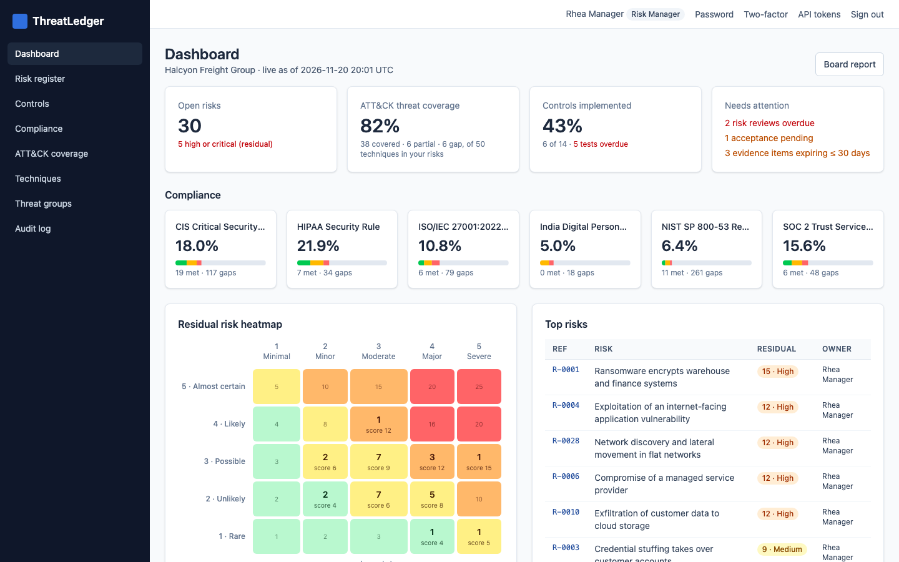
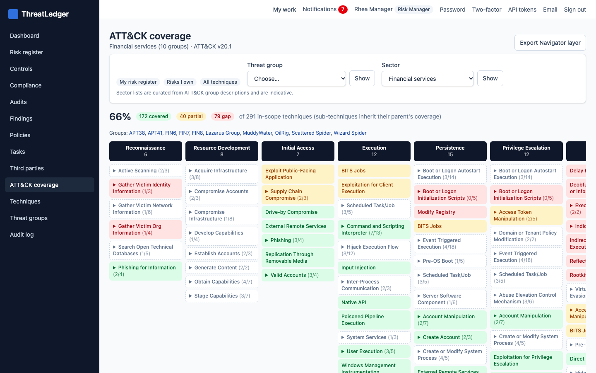
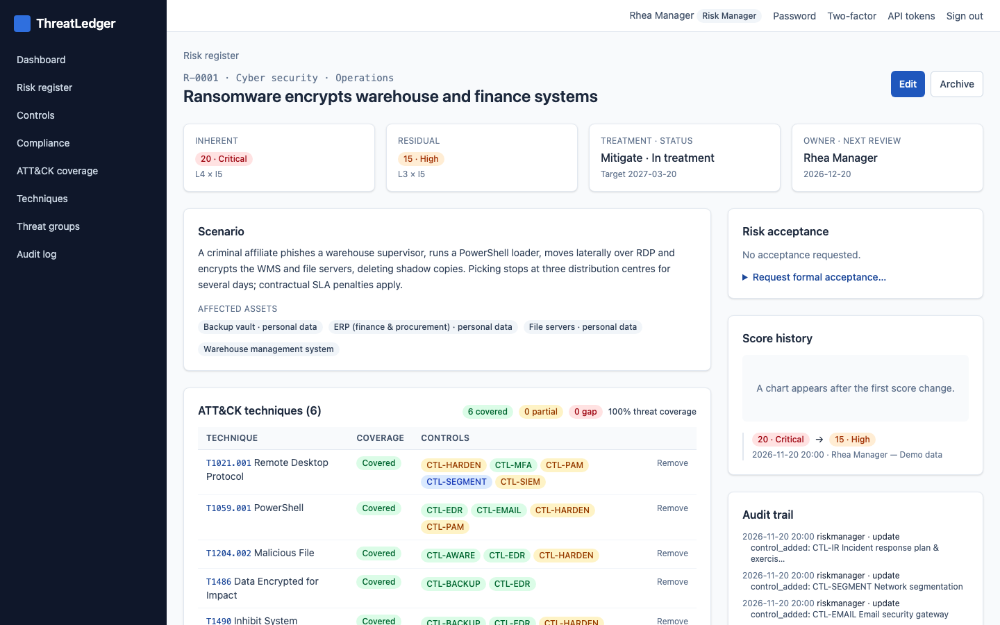
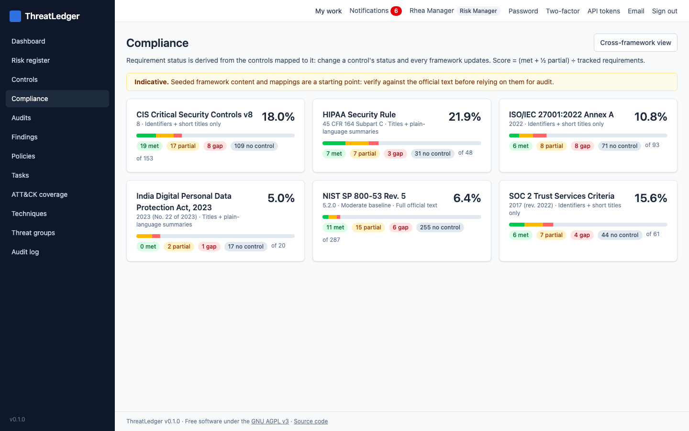
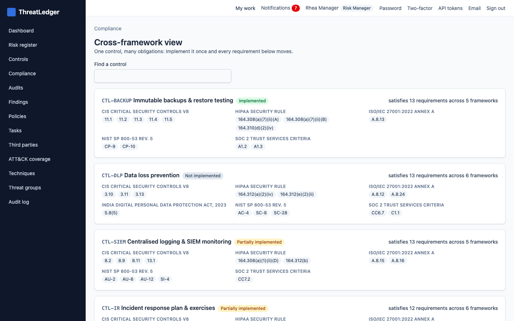
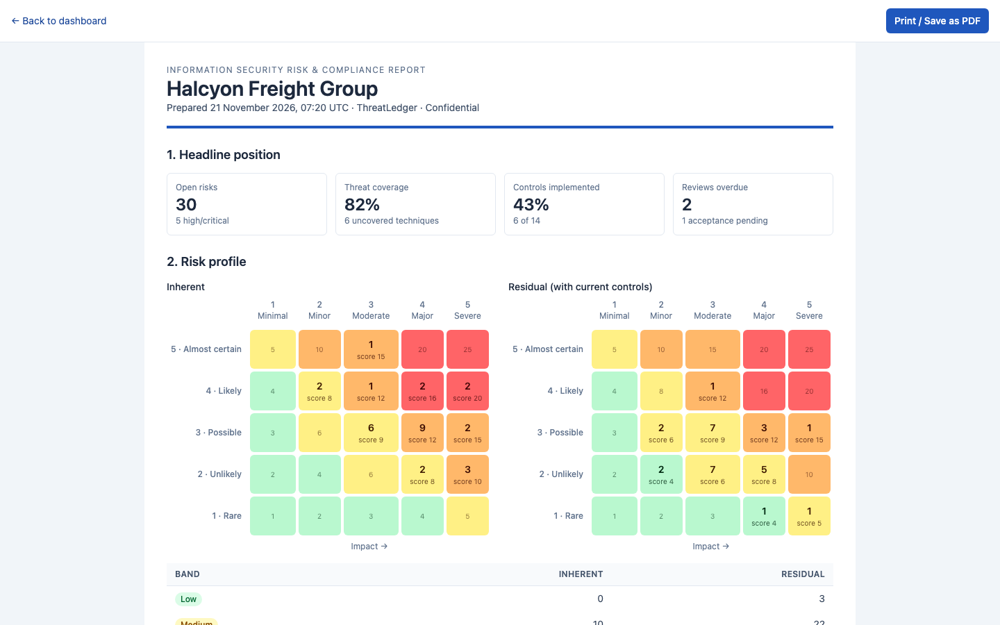
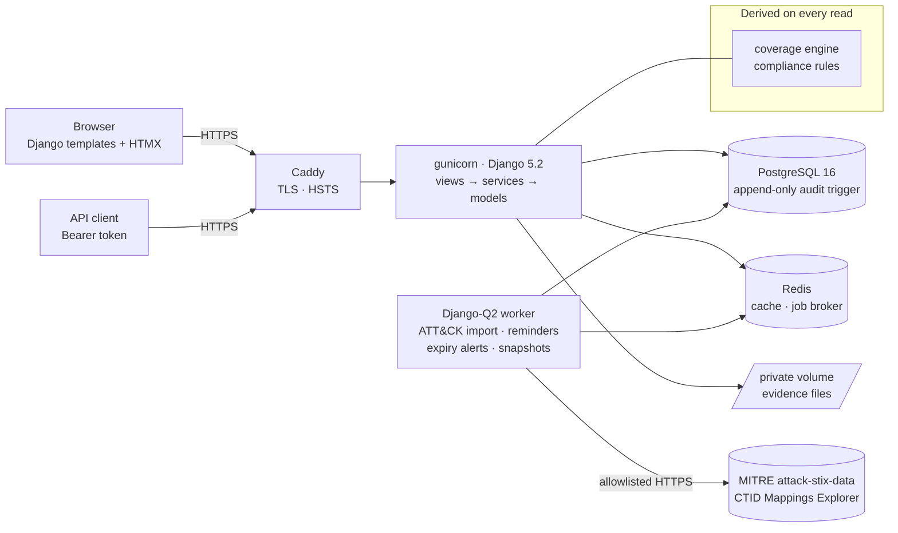

# ThreatLedger

**Open-source, threat-informed GRC.** ThreatLedger links your risk register to MITRE ATT&CK
techniques, your security controls and your compliance frameworks, so a single control change shows
its effect everywhere at once:

```
Risk scenario ──uses──▶ ATT&CK techniques ◀──mitigates── Controls ──satisfies──▶ Framework requirements
```

Mark MFA as *implemented* and, without any sync job, threat coverage rises on every risk that relies
on stolen credentials, and compliance rises in NIST 800-53, ISO 27001, SOC 2, HIPAA, CIS v8 and the
DPDP Act wherever MFA is mapped.

- **Risk register:** configurable 5×5 matrix, inherent and residual heatmaps, score history,
  acceptances with segregation of duties, review reminders, safe CSV/Excel export.
- **ATT&CK:** idempotent import of the official STIX data. Revoked techniques are kept and remapped,
  never silently dropped. Includes a coverage matrix by risk register, threat group or sector, and
  ATT&CK Navigator export.
- **Controls & evidence:** starter library of 14 controls, validated private evidence uploads with
  expiry alerts, and test records.
- **Compliance:** six seeded frameworks, an importer for your own, gap views, a cross-framework
  view, and CTID ATT&CK↔NIST mappings.
- **Reporting:** executive dashboard, printable board report and trend charts.
- **Secure by default:** strict CSP, MFA, account lockout, hashed API tokens, an immutable
  hash-chained audit log, non-root read-only containers. See [SECURITY.md](SECURITY.md).

## Screenshots

Demo data (`seed_demo`): the fictional Halcyon Freight Group, with ATT&CK v20.1. Regenerate the
images with `make screenshots` (see [docs/screenshots/README.md](docs/screenshots/README.md)).

| Dashboard | ATT&CK coverage | Risk detail |
|---|---|---|
|  |  |  |
| **Compliance** | **Cross-framework** | **Board report** |
|  |  |  |

## Quick start (Docker)

Needs only Docker with the Compose plugin, on Linux, macOS or Windows.

```sh
git clone https://github.com/jaikraghavan/Threatledger.git threatledger && cd threatledger
docker compose up -d --build                 # first start generates all secrets
docker compose exec web python manage.py import_attack      # MITRE ATT&CK Enterprise (≈ 1 min)
docker compose exec web python manage.py seed_demo --allow-production   # demo company + users
```

Open **https://localhost**. Caddy issues a local certificate, so your browser will warn once. The demo
users are `admin`, `riskmanager`, `controlowner`, `auditor` and `viewer`. Their passwords are printed
once by `seed_demo`; set `SEED_PASSWORD` before running it to choose your own.

For a real deployment, skip the demo:

```sh
echo "DOMAIN=grc.example.com" > .env                       # public name → Let's Encrypt certificate
docker compose up -d --build
docker compose exec web python manage.py createsuperuser   # break-glass admin (Django admin only)
docker compose exec web python manage.py seed --allow-production   # or create users in /admin
docker compose exec web python manage.py import_attack
docker compose exec web python manage.py seed_controls     # optional starter library
docker compose exec web python manage.py seed_frameworks   # NIST, ISO, SOC 2, HIPAA, CIS, DPDP
docker compose exec web python manage.py import_ctid_mappings
```

Give people roles by adding them to the organisation in **/admin → Users → Memberships**. Limit a user
to certain business units by selecting those units on their membership.

## Loading MITRE ATT&CK

```sh
docker compose exec web python manage.py import_attack                 # latest Enterprise release
docker compose exec web python manage.py import_attack --version 20.1  # pin a version
# Air-gapped: download enterprise-attack-<ver>.json from github.com/mitre-attack/attack-stix-data
docker compose cp enterprise-attack-20.1.json web:/tmp/b.json
docker compose exec web python manage.py import_attack --file /tmp/b.json --sha256 <expected>
```

Admins can also run imports from **ATT&CK data** in the app, on the background worker.
Re-importing is idempotent. When MITRE revokes a technique, ThreatLedger keeps it, flags it and
offers a one-click remap to the replacement, so your mappings never break. Importing an older
version over a newer one is refused unless you pass `--allow-downgrade`.

## Frameworks

| Framework | Content shipped | Why |
|---|---|---|
| NIST SP 800-53 r5 | Full official text + Low/Moderate/High baselines (from NIST OSCAL) | Public domain |
| ISO/IEC 27001:2022 Annex A | Control IDs + short titles | Copyrighted |
| SOC 2 Trust Services Criteria | Criterion IDs + paraphrased titles | Copyrighted |
| CIS Controls v8 | Safeguard IDs + paraphrased titles | CC BY-NC-SA licence |
| HIPAA Security Rule | Official headings + plain-language summaries | Public law (summarised, not verbatim) |
| India DPDP Act 2023 | Official headings + plain-language summaries | Public law (summarised, not verbatim) |

Load your licensed text or any other framework with
`manage.py import_framework file.yaml|json|csv [--dry-run]`, or from **Compliance → Import framework**.
The file format is documented in `threatledger/frameworks/importer.py`. **All seeded content and
mappings are indicative: verify them against the official text before relying on them in an audit.**

## Backup and restore

```sh
docker compose exec web python manage.py backup          # → /srv/backups (the "backups" volume)
docker compose exec web python manage.py verify_backup /srv/backups/threatledger-backup-<ts>.tar.gz
docker compose exec web python manage.py restore /srv/backups/threatledger-backup-<ts>.tar.gz --force
docker compose exec web python manage.py audit_verify    # after a restore
```

Each archive contains a PostgreSQL custom-format dump, all media and evidence files, and a manifest
with SHA-256 checksums. Restore verifies everything before changing anything. Copy archives off the
host, for example with `docker compose cp web:/srv/backups ./backups`, and protect them: they hold all
your risk data and evidence. Back up the `secrets` volume separately, because without it the restored
database's passwords won't match.

**Restore drill (do this quarterly):** start a fresh stack on another host, restore the latest archive,
run `audit_verify`, and spot-check a few risks and evidence downloads.

## Configuration

Set these in `.env`, next to `docker-compose.yml`. Secrets are generated automatically; don't put
passwords here.

| Variable | Default | Purpose |
|---|---|---|
| `DOMAIN` | `localhost` | Public hostname; Caddy gets a Let's Encrypt certificate for it |
| `HTTP_PORT` / `HTTPS_PORT` | `80` / `443` | Published ports |
| `SITE_URL` | `https://$DOMAIN` | Absolute links in emails |
| `MFA_REQUIRED_ROLES` | *(empty)* | Comma-separated roles that must use TOTP, e.g. `admin,risk_manager` |
| `SESSION_IDLE_TIMEOUT` | `1800` | Seconds of inactivity before sign-out (`0` disables) |
| `SESSION_COOKIE_AGE` | `28800` | Absolute session lifetime in seconds |
| `AXES_FAILURE_LIMIT` / `AXES_COOLOFF_MINUTES` | `5` / `15` | Account lockout |
| `API_THROTTLE_USER` / `API_THROTTLE_ANON` | `2000/hour` / `30/hour` | API rate limits |
| `EVIDENCE_MAX_BYTES` | `26214400` | Max evidence upload (25 MB) |
| `ATTACK_MAX_BUNDLE_BYTES` | `209715200` | Max ATT&CK bundle size (200 MB) |
| `AUDIT_IP_MODE` | `full` | `truncated` stores /24 (IPv4) or /48 (IPv6) for privacy |
| `EMAIL_HOST`, `EMAIL_PORT`, `EMAIL_HOST_USER`, `EMAIL_HOST_PASSWORD`, `EMAIL_USE_TLS`, `DEFAULT_FROM_EMAIL` | none | SMTP for review reminders and evidence-expiry alerts |
| `SECURE_HSTS_SECONDS` / `SECURE_HSTS_PRELOAD` | `31536000` / `false` | HSTS; preload is opt-in |
| `GUNICORN_WORKERS` / `Q_WORKERS` | `3` / `2` | Web and background worker processes |
| `LOG_LEVEL` / `TIME_ZONE` | `INFO` / `UTC` | Logging and time zone |

Generated automatically into the `secrets` volume: `DJANGO_SECRET_KEY`, the PostgreSQL password and
the Redis password.

## Architecture



All writes go through a service layer that enforces permissions and writes the audit log. Technique
coverage, requirement status and compliance percentages are **computed from control status on every
read** and never stored. Daily snapshots exist only to draw trend charts.

## How to use this for GRC

1. **Set the scene.** Adopt the frameworks you report against (**Compliance**). Pick the NIST baseline
   and mark out-of-scope requirements *N/A* with a justification. Adjust the risk matrix if your
   policy isn't 5×5 (**Risk matrix**).
2. **Build the control library.** Load the starter set, rename or extend it to match what you
   actually run, assign an owner to each control, and set an honest status. Map each control to the
   ATT&CK mitigations it implements and the framework requirements it satisfies.
3. **Write threat-informed risks.** For each risk, describe the scenario (threat → weakness →
   impact), link the affected assets, and add the ATT&CK techniques an adversary would use. The risk
   page then shows which techniques are covered, partial or gaps, and suggests existing controls
   that address them.
4. **Score twice.** Inherent is before controls; residual is with the controls that are actually
   working. A residual you can't justify from the coverage panel is a finding.
5. **Prove it.** Control owners attach evidence (with expiry dates) and record tests. Auditors get
   read-only access to all of it, including the audit trail.
6. **Treat or accept.** Plan treatment with target dates. Formally accept residual risk only through
   an acceptance request: a different person must approve it, and it expires automatically.
7. **Report.** Use the dashboard for weekly operations and the board report (print to PDF) each
   quarter. Export the ATT&CK coverage of a threat group or sector to Navigator for your SOC.
8. **Keep it current.** Re-import ATT&CK after each MITRE release; review revoked-technique banners.
   Owners get review reminders and evidence-expiry emails. Automate status updates through the API,
   for example `PATCH /api/v1/controls/CTL-EDR/` from your EDR deployment pipeline.

## REST API

Create a personal token under **Account → API tokens**, then:

```sh
curl -H "Authorization: Bearer tl_xxxxxxxx_…" https://grc.example.com/api/v1/risks/
```

The API covers risks, controls, techniques with coverage, framework compliance, coverage and
Navigator layers, and the audit log. The OpenAPI schema is at `/api/v1/schema/` and readable docs at
`/api/v1/docs/`. Tokens act with their owner's role, and every write is audited.

## Local development

```sh
make install   # uv sync (Python 3.12 + dependencies)
make env       # .env with a random secret key
make run       # builds CSS, migrates, runs http://127.0.0.1:8000
make check     # lint, types, tests (coverage gate), bandit, pip-audit
```

See [CONTRIBUTING.md](CONTRIBUTING.md) and [CLAUDE.md](CLAUDE.md). Performance check against a
loaded instance: `manage.py perf_check --risks 1000`.

## Licence

GNU Affero General Public License v3.0 or later (AGPL-3.0-or-later). See [LICENSE](LICENSE) and
[NOTICE](NOTICE). If you run a modified ThreatLedger as a network service, AGPL §13 requires you to
offer its source to your users: set `SOURCE_CODE_URL` to your version's source (the link is shown in
every page footer). Releases up to and including v0.1.0 were published under Apache-2.0 and remain
available under it.

ATT&CK® is a registered trademark of The MITRE Corporation, used
under MITRE's terms of use. CTID mappings © Center for Threat-Informed Defense (Apache-2.0). NIST SP
800-53 is a US Government work.
